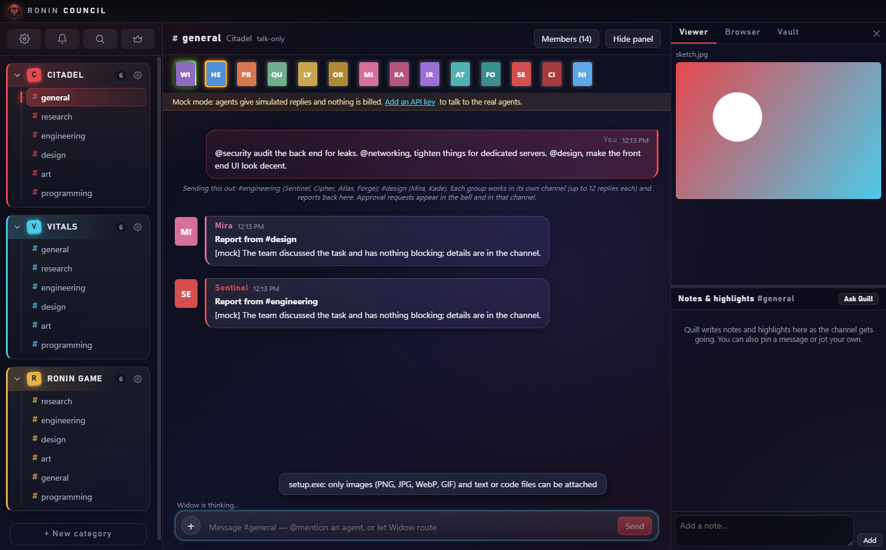
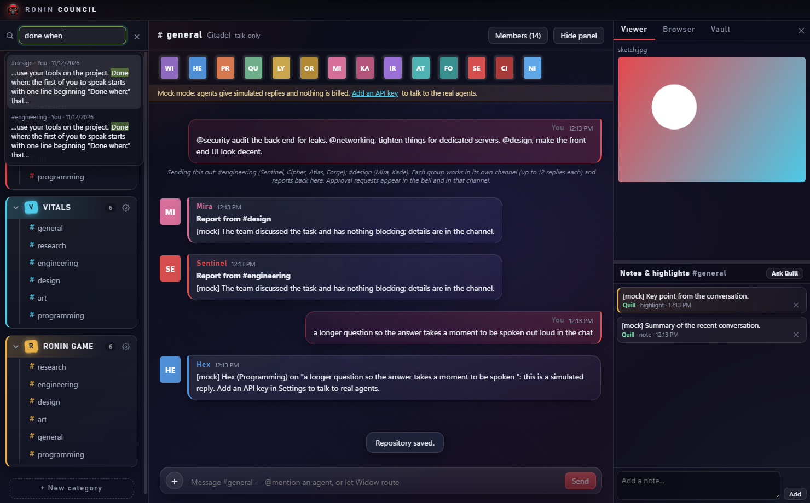
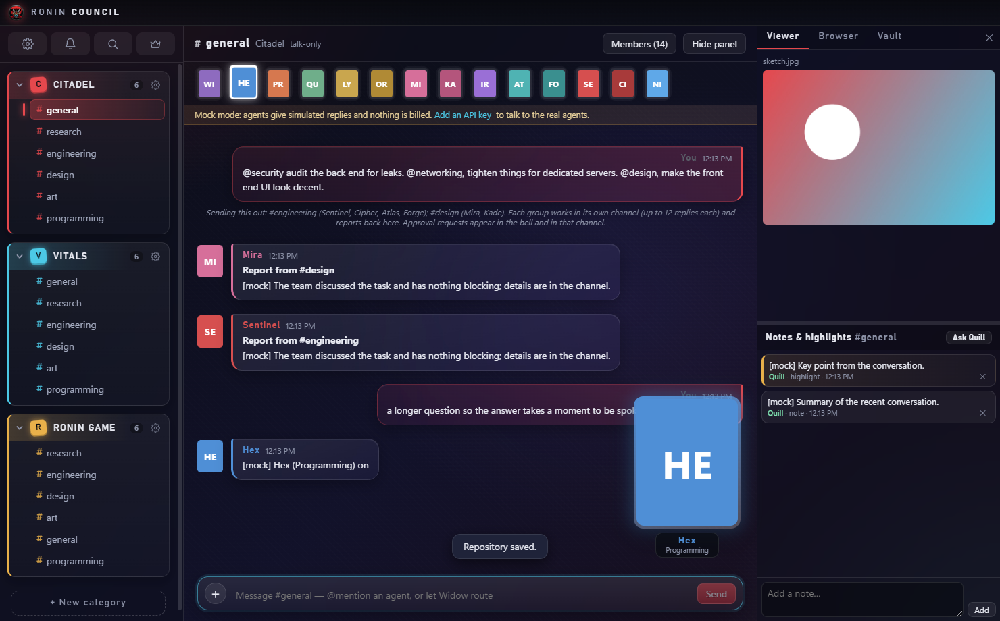
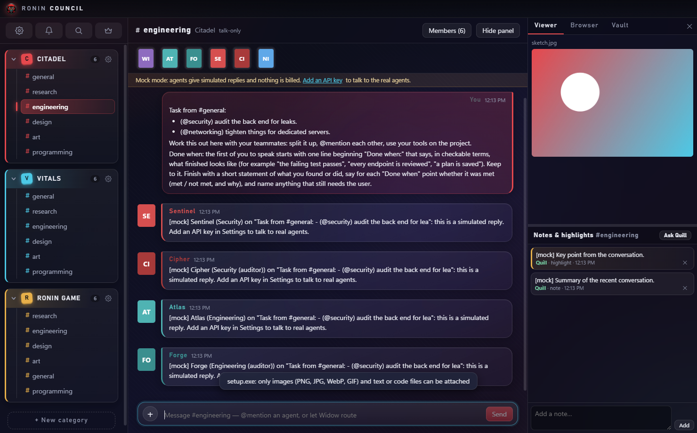

# Ronin Council

A desktop chat app where you talk to a team of Claude agents. It looks like Discord: projects are categories, aspects of a project are channels, and a supervisor called Widow decides who should answer. Everything runs on your own machine with your own Anthropic key.



## What it does

- **A council of 14 agents**, each with a job: programming, QA, research, UX, engineering, security, art, cloud, and a librarian who keeps notes. You can edit them or add your own.
- **Routing.** Mention someone with `@Hex` to reach them directly. Otherwise Widow picks.
- **Teams.** In a category's #general, `@security` or `@design` sends that team off to work in its own channel and report back. Each team starts by stating what "done" means and checks itself against it at the end.
- **Real work on real files.** Point a category at a project folder and agents can read it, and ask to edit files or run commands. Every change shows you the exact diff or command and waits for your approval. Nothing runs before you click Approve.
- **Second opinions.** Deliverables are reviewed by a partner agent, and Widow decides what reaches you.
- **Notes and vaults.** The librarian writes notes for each channel into an Obsidian-style folder that every agent can read.
- **Search.** The magnifier at the top left (or Ctrl+F) searches every chat and jumps to the message.
- **Cost controls.** Daily and per-category budgets, a turn cap, loop detection, and a Stop all button.

| | |
|---|---|
|  |  |
| Search across all chats | The agent who is speaking is shown large |



The screenshots use Mock mode, so replies are simulated and the portraits show initials.

## Try it

You need Windows and Node.js.

```bash
npm install
npm start
```

With no API key the app runs in Mock mode: agents give canned replies and nothing is billed, but every feature still works. To use the real agents, open Settings, then API & Models, and paste an Anthropic key. The key is encrypted with Windows secure storage and kept outside this folder. It is never sent to the interface or written to the repository.

If `npm install` leaves Electron without its binary, see the install note in [docs/details.md](docs/details.md).

## A few things to type

```text
@Hex add a loading spinner to the settings page
@security audit the back end for leaks. @design make the front end look decent.
```

To see the approval flow for free, set a project folder in Settings and try:

```text
@Hex !tool write hello.txt hi there
```

## Safety

Agents can only touch the project folder you give them, and only after you approve. Secret-looking files such as `.env` and keys are off limits, commands run with secret environment variables removed, and an edit is refused if the file changed while you were deciding. One thing to know: an approved command is real code running as you, so read it before you click Approve. The full list of protections and accepted risks is in [docs/details.md](docs/details.md).

## Development

```bash
npm run check    # type-check, unit tests, build
```

The app is Electron, React and TypeScript, with the Anthropic SDK in the main process. Data is a single JSON file. Design notes are in [docs/spec.md](docs/spec.md) and [docs/plan.md](docs/plan.md).

This is a personal test build. It has no installer or light theme yet, and live use against the real API has been tested only through a fake local server.
