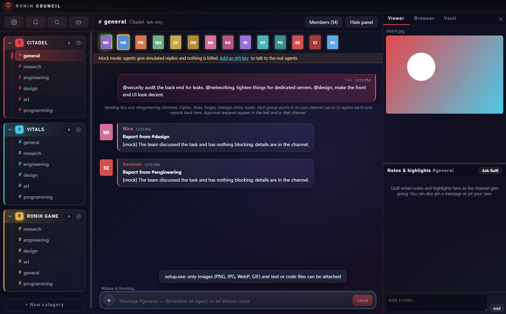
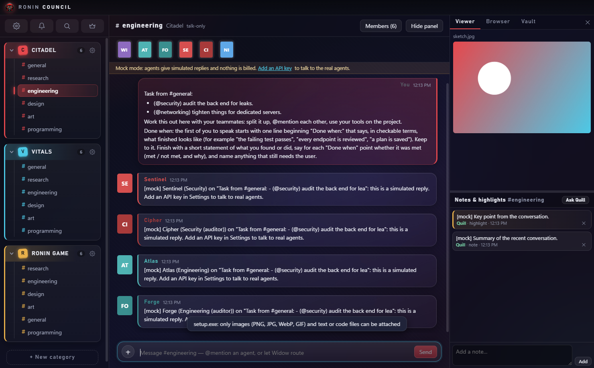
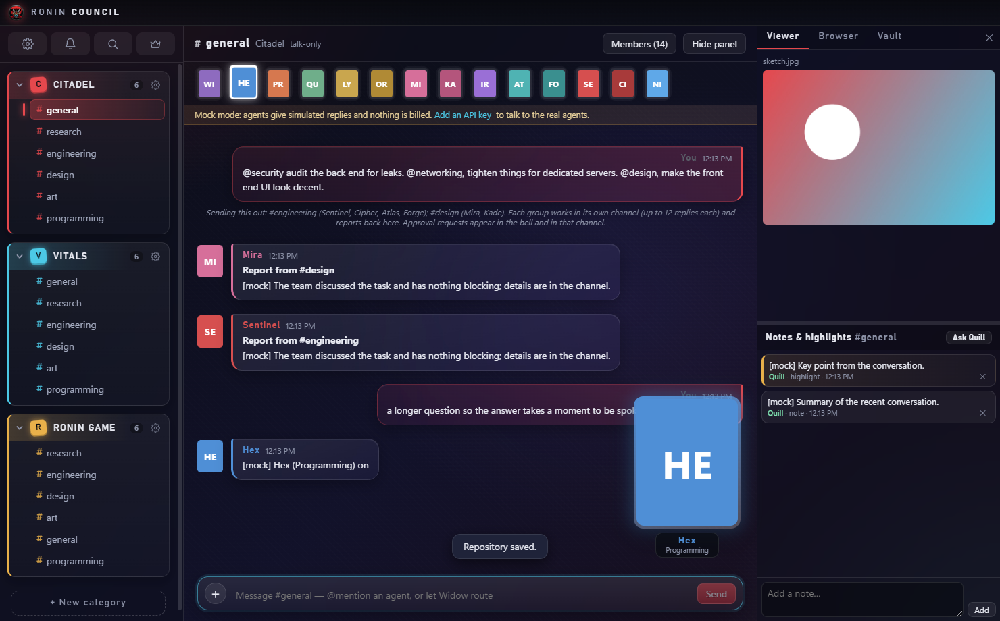
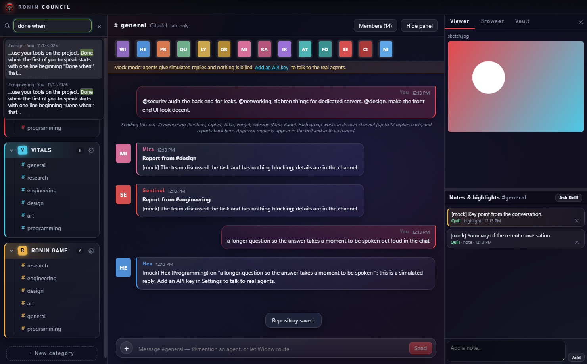

# Ronin Council: full details

A private, local, Discord/Teams-style desktop app: you plus a council of Claude agents, organised into
**categories** (projects) and **channels** (aspects of a project), supervised by **Widow**.
Design and decisions: [spec](spec.md) · build plan: [plan](plan.md).

> Test build for Windows, built with Electron, React and TypeScript. Agents run on the Anthropic API using your own key;
> with no key it runs in free Mock mode. It is a personal project: no installer yet, and no warranty.



## Screenshots

| | |
|---|---|
|  **Delegation.** `@security …  @design …` in #general sends each team to its own channel; they report back. |  **Speaker spotlight.** The agent who is talking appears large, then fades when they finish. |
|  **Search.** The magnifier (or Ctrl+F) searches every chat and jumps to the message. | |

(Screenshots are from Mock mode, so the replies are simulated and portraits show initials.)

## Examples

Talk to one agent, or let Widow route:

```text
@Hex add a loading spinner to the settings page      # goes straight to Hex (Programming)
Can someone check whether our login flow is safe?    # Widow routes it to the right specialist
```

Send work to several teams at once from a category's #general:

```text
@security audit the back end for leaks. @networking tighten things for dedicated servers. @design make the front end UI look decent.
```

Each team works in its own channel, opens with a "Done when:" line, and Widow reports back to #general.

Try the approval flow for free (Mock mode, with a project folder set in Settings → Vaults & Projects):

```text
@Hex !tool write hello.txt hi there     # shows the exact diff; nothing is written until you press Approve
@Hex !tool read hello.txt
@Hex !tool run echo hi
```

## Privacy and secrets
Your API key is entered in the app, encrypted with the operating system's secure storage and kept outside this folder. It is never
written to the repository. Chats, notes and backups live in `%APPDATA%\Ronin Council` (not in the project) and are git-ignored if you run
the self-test, which keeps its data in `.selftest-data/`.

## Run it

```bash
npm install          # first time only (see "Install note" below)
npm start            # builds, then opens the app
```

With no API key the app runs in **Mock mode**: agents give simulated replies, nothing is billed, and every
feature (routing, audits, permissions, notes, vaults) can be exercised for free. To use the real agents,
open **Settings → API & Models**, paste an Anthropic API key and save. The key is encrypted with the OS
secure storage and never reaches the interface.

### Install note
npm 12 blocks dependency install scripts by default. Electron needs its script to download the app binary:

```bash
npm install-scripts approve electron esbuild
node node_modules/electron/install.js
```

If the extraction leaves `node_modules/electron/dist` nearly empty, unzip the cached
`electron-v33.x-win32-x64.zip` (in `%LOCALAPPDATA%\electron\Cache`) into that folder and create
`node_modules/electron/path.txt` containing `electron.exe`.

## Checks

```bash
npm run check        # type-check, unit tests, build
```

UI self-test (launches the real app, drives it, saves screenshots and `results.json`):

```bash
RC_SELFTEST="$PWD/.selftest" RC_USERDATA="$PWD/.selftest-data" ./node_modules/electron/dist/electron.exe .
```

`RC_USERDATA` keeps test data away from your real data. Data normally lives in `%APPDATA%\Ronin Council`.

## What works in 0.1
- Categories and channels: collapse, rename, add, delete, drag to reorder. Channels reorder only inside their own category.
- 14 seeded agents (editable): Widow, Programming, QA, Librarian, Research x2, UX x2, Engineering x2, Security x2, Art, and Nimbus (cloud integration: hosting, storage, queues, auth providers, third-party APIs, CI/CD; audited by Cipher; reached with @cloud, @aws, @integration or @devops). An existing council gets Nimbus once on the next start; remove it and it stays removed.
- Routing: `@mention` goes straight to that agent; otherwise Widow routes. Agents can `@` each other.
- Audit pairs: a `DELIVERABLE:` is reviewed by the partner, Widow decides, one revision, then it escalates to you.
- Safeguards: turn cap, daily and per-category budgets, repeat-loop detection, a Stop button per channel, and a red **Stop all** in the title bar while anything runs.
- **Backups** (Settings → Backup): Back up now, restore from a list, and an automatic one once a day (last 7 kept). Holds agents, chats, notes, settings and attached files; not vault or project folders, and never the API key. A restore first saves the current state, so it can be undone.
- **Agents can work on real files (phase 6).** Set a *project folder* per category in Settings → Vaults & Projects.
  Agents there can read, list and search files freely, and request to write/edit files or run commands.
  Every change or command goes: agent → **Widow's audit** → **you** (an inline card in that channel, or the
  notifications centre if you are elsewhere) showing the exact diff or command. Nothing happens until you press Approve.
  Deny, or press Stop, and it never runs; the agent is told it was not approved. Without a project folder agents stay talk-only.
- Chat shows each tool call as a quiet row (click to expand the output or diff).
- Right panel: viewer (code, images, files), browser (http/https only), vault browser, notes and highlights.
- Chat renders Markdown (bold, lists, tables, links, code) safely: no raw HTML is ever injected, only http(s) links.
- **Quill** (the Librarian) writes each channel's notes and highlights automatically after enough has been said
  (fast tier, a few cents a day at most; toggle in Settings → Budgets, or press "Ask Quill" in the Notes panel).
- Agents can read the vaults themselves (`list_vault` / `read_vault`, any project, text only, free, framed as untrusted data).
  They are offered these only when some vault has notes.
- Look: gradient background, glass chat bubbles, colour-coded category tree, custom title bar and taskbar icon
  (master `assets/Logo/Logo.webp`, 1024 px with transparency; after changing it run `node_modules/electron/dist/electron.exe scripts/make-icons.js`
  to rebuild `Logo.ico` at 16-256 px and the small title-bar image).
- Vaults: one folder per category, a generated `_Other Vaults.md` cross-vault index, every agent can read any vault, writes only via Librarian/Widow.
- Agent profile popup (click any avatar): channels, status, tier, personality editing.
- **Attachments.** Drag images or text/code files from File Explorer onto the chat, press the **+** next to the box, or paste an
  image. Up to 6 per message; images are shrunk to 1568 px if larger (the API's 5 MB image cap), text files up to 100 KB.
  Agents see the newest message's files only (images as pictures, text framed as untrusted data); earlier ones appear in the
  transcript by name. Bytes are stored in an `attachments` folder beside the database, not in it. PDFs and other types are not supported yet.
- **Vendors and models.** Every agent has a vendor and model (its profile), defaulting to its tier on Anthropic. Hosted vendors have a fixed address, so a key can only be sent to that vendor. Local and custom services have an address you set, which must be https, or http on this computer only. Each vendor has its own key. Models without a price in Settings are refused (so budgets hold); local models are free. A model's tool use (file edits, commands) is on for hosted vendors and off for local ones, and can be changed per model. Anthropic-only features (prompt caching, thinking blocks) do not apply to other vendors. Checked against a fake local server only, not the real vendors.
- **Short replies and caching.** Agents are told to answer like a teammate in chat (one to three sentences unless the work needs more) and not to @mention each other just to agree. The part of every prompt shared by a project's team is cached for an hour (cheap reads, billed at the real cached rates); Settings → Budgets shows how many input tokens were read from the cache. Default replies per message is now 12 (an old setting of 8 moves up).
- **Saving reports and publishing.** Agents can `save_note` a finished audit or plan into the project's Obsidian vault, and `git_publish` to commit and push the checked-out branch to the project's linked GitHub repo. Both go through Widow's audit and your approval, showing the exact text or file list; git_publish never forces, refuses secret-looking files (.env, keys), refuses if the files changed after you approved, and only pushes to the repo linked in Settings.
- **Roster.** Under the channel header, every member's portrait (hover for name and job); a lime line runs around the portrait of an agent who is working, and an amber edge marks one waiting on your approval.
- **Speaker spotlight.** When an agent's reply arrives, it is typed out and that agent's portrait appears large above the composer (click it to skip ahead), then fades when they finish. Replies queue one at a time, faster when many are waiting. Turn it off in Settings → Agents; it is also off if the system asks for reduced motion.
- **Chat search.** The magnifying glass beside the bell (or Ctrl+F) opens a search bar over the top bar. It looks through every channel's messages (all words must match, any case, newest first; system notes are skipped), free and instant. Arrow keys and Enter, or a click, jump to the message: the channel opens, the row scrolls into view and flashes.
- **"Done when" in delegations.** A brief sent from #general asks the team to open with a "Done when:" line, to check each point at the end (met / not met, and why), and Widow's report back to #general says whether it was met. This is an instruction to the agents, not a hard check, so it is only as good as they are at following it.
- **Category cog.** The gear at the right edge of each category name opens that category's vault, project folder and repository settings without going through the full Settings.
- **Profile pictures.** Click an agent's avatar, then *Change picture*. PNG, JPG, WebP or GIF up to 10 MB; the editor lets you
  move and zoom inside a portrait frame and saves a portrait 256 × 320 WebP (4:5, like 1122 × 1402; at most 300 KB). Also available when adding an agent in Settings.

## Safety model for agent actions
- Files: confined to the project folder (relative and absolute paths, symlinks and junctions are checked); `.git`,
  `node_modules` and secret-looking files (`.env`, keys, `credentials`...) are off limits for reads and writes.
- Commands run in the project folder with secret-looking environment variables removed, a timeout (default 2 min,
  max 10) and capped output. A command is real code running as **you**: it can touch anything you can, so read
  the command on the approval card before approving. Approval is the safety boundary, not a sandbox.
- Edits must match exactly once, and are re-checked at the moment they run (if the file changed while you were
  deciding, the edit is refused).
- At most 12 model calls per agent turn; the daily and per-category budgets apply to every step.
- Approval requests do not survive a restart (they expire), and Stop withdraws anything waiting.
- You and Widow always review the **complete** change. A change too big to review in full is refused (the agent is told
  to split it). Hidden characters (bidi overrides, zero-width, control) are shown as `⟦U+XXXX⟧`; commands must be one line.
- Fail closed: if Widow's audit cannot run (budget reached, API down), the request is blocked and is **not** forwarded to you.
- Windows tricks are refused (`.env::$DATA`, trailing dots/spaces, 8.3 short names like `ENV~1`, `CON`/`NUL`, any letter case
  of `.git`), writes through links/junctions are refused, and everything is re-validated at the moment a change runs.
- A project folder cannot overlap this app's own data or system folders.

### Accepted risks (by design, so you know them)
- `run_command` is real code running as you. It can `cd` anywhere, read any file you can (including `.env`, and this app's
  encrypted key file), and its output goes to the model and to Anthropic. Only your reading of the command protects you.
- Widow can be fooled by hostile text in files the way any model can; her audit is a second opinion, you are the gate.
- A command may leave child processes running after a timeout. Hard links inside the project to outside files are not detected.
- Command output on Windows is shown in the console's code page, so non-English text can look garbled.
- Long tool loops re-send their context each step without prompt caching, so file-heavy turns cost more than they need to.

Try it free in Mock mode: set a project folder, then in that project's channel send
`@Hex !tool write hello.txt hi there`, `@Hex !tool read hello.txt`, or `@Hex !tool run echo hi`.

## Not built yet
Agent browser control; a second-provider research partner; SQLite (data is one JSON file behind the `Store` class); installer; light theme.

## Known limits (found in review, deliberately deferred)
- Every change sends the whole message history to the interface and rewrites the one JSON file. Fine for thousands of
  messages; expect lag beyond that. The fix (SQLite, paged history) is planned with the storage swap.
- A number field in Settings (e.g. turn cap) can keep showing the typed value if it was clamped to the same number as before.
- The Testing tools and the self-test hooks only work in unpackaged (development) runs, by design.

Real-API behaviour has been verified against a fake local API server only; live use is the user's own testing, so prompt caching hits and cost figures are unconfirmed by the tests.
